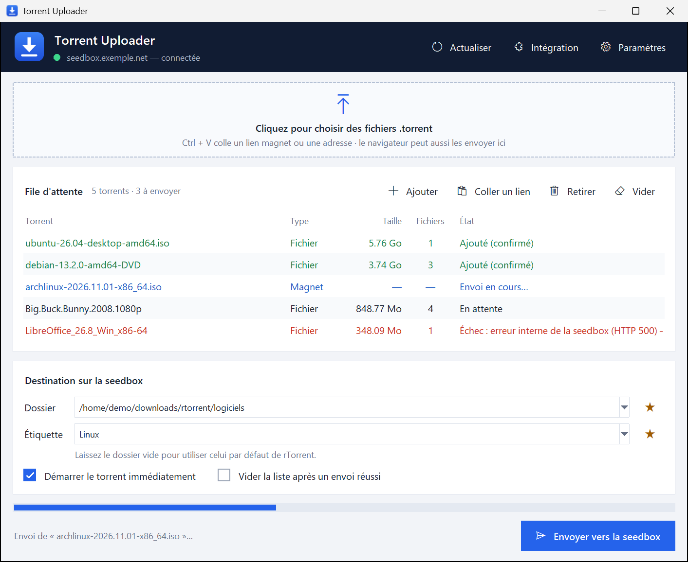
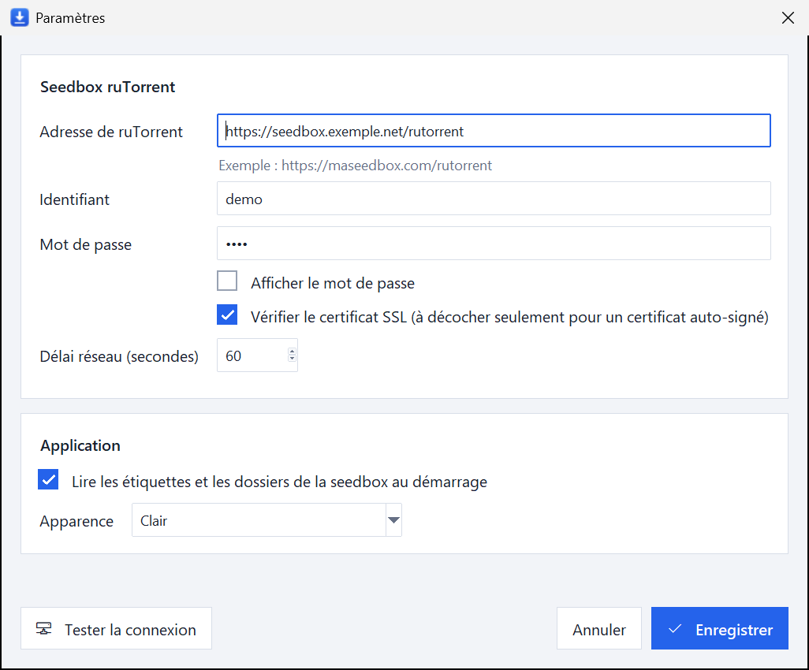
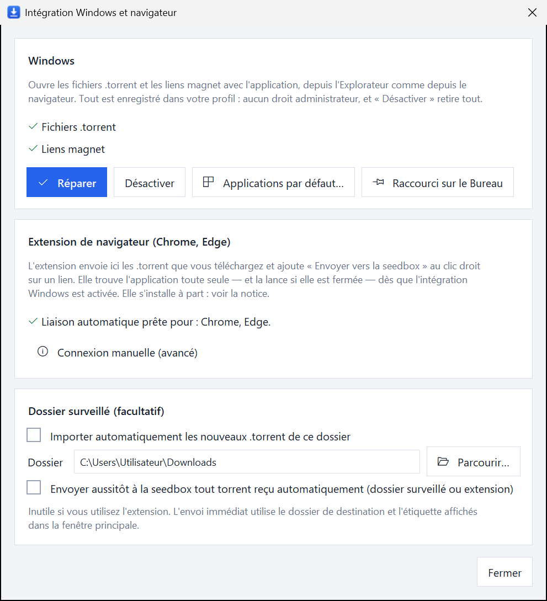
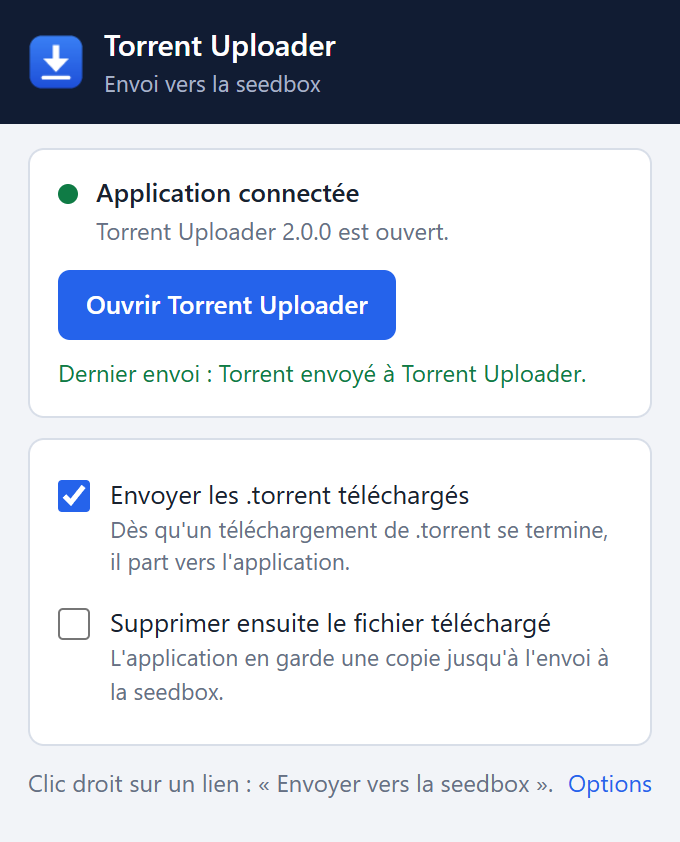
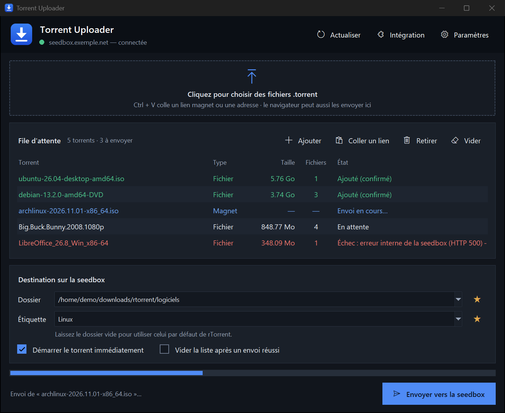

# Torrent Uploader 2

*[English version](README.md)*

Application Windows (Python + tkinter) qui envoie des fichiers `.torrent` et des liens **magnet**
vers une seedbox **ruTorrent / rTorrent**, en choisissant à chaque fois le dossier de destination et
l'étiquette.



Les torrents peuvent arriver de trois façons :

- **depuis Windows** : double-clic sur un `.torrent`, clic sur un lien magnet, glisser-déposer sur
  l'application ou sur son raccourci ;
- **depuis le navigateur** (Chrome ou Edge, avec l'extension fournie) : un `.torrent` téléchargé part
  automatiquement vers l'application, et un clic droit sur un lien propose « Envoyer vers la seedbox » ;
- **à la main** : bouton « Ajouter », ou <kbd>Ctrl</kbd> + <kbd>V</kbd> pour coller un lien.

## Sommaire

1. [Installation](#1-installation)
2. [Premier lancement](#2-premier-lancement)
3. [Utilisation au quotidien](#3-utilisation-au-quotidien)
4. [Intégration à Windows](#4-intégration-à-windows)
5. [Extension Chrome et Edge](#5-extension-chrome-et-edge)
6. [Dossier surveillé](#6-dossier-surveillé)
7. [Paramètres](#7-paramètres)
8. [Données et sécurité](#8-données-et-sécurité)
9. [Mise à jour depuis la version 1](#9-mise-à-jour-depuis-la-version-1)
10. [Désinstallation](#10-désinstallation)
11. [Dépannage](#11-dépannage)
12. [Fonctionnement technique](#12-fonctionnement-technique)
13. [Développement](#13-développement)

## 1. Installation

**Ce qu'il faut**

- Windows 10 ou 11.
- **Python 3.8 ou plus récent**, installé depuis [python.org](https://www.python.org/downloads/).
  Gardez les options proposées par défaut (elles installent `pythonw.exe` et l'association des
  fichiers `.pyw`).
- Une seedbox **ruTorrent** : son adresse, votre identifiant et votre mot de passe.
- Facultatif : **Google Chrome** ou **Microsoft Edge**, pour l'extension.

> **Attention à la version « Microsoft Store » de Python.** Si la commande `python` ouvre le
> Microsoft Store, Python n'est pas réellement installé : installez-le depuis python.org.
> L'application refuse d'ailleurs de s'enregistrer auprès de Windows avec ce faux Python.

**Mise en place**

1. Copiez le dossier **Torrent Uploader** à l'endroit de votre choix, par exemple dans `Documents`.
   Il n'y a rien d'autre à installer.
2. Copiez aussi le dossier de l'extension si vous comptez l'utiliser, à un emplacement où il
   restera : le navigateur le lit en permanence.
3. Facultatif : pour **glisser-déposer directement dans la fenêtre**, tapez `pip install tkinterdnd2`.
   Sans ce module, tout le reste fonctionne (bouton « Ajouter », raccourci, collage, navigateur).

## 2. Premier lancement

Double-cliquez sur **Torrent Uploader.pyw** (ou sur **Torrent Uploader.bat**). Au tout premier
lancement, la fenêtre des paramètres s'ouvre d'elle-même :



1. **Adresse de ruTorrent** : l'adresse que vous ouvrez dans votre navigateur, par exemple
   `https://maseedbox.com/rutorrent`. Vous pouvez la coller telle quelle, même terminée par
   `/php/addtorrent.php`.
2. **Identifiant** et **mot de passe** de l'interface web.
3. Cliquez sur **Tester la connexion** : le nombre de torrents, d'étiquettes et de dossiers trouvés
   s'affiche.
4. **Enregistrer**.

> **Conseil :** ouvrez ensuite **Intégration** et cliquez sur **Activer** (voir §4) : c'est ce qui
> permet d'ouvrir les `.torrent` et les liens magnet d'un simple clic, et à l'extension du
> navigateur de fonctionner.

## 3. Utilisation au quotidien

**Ajouter des torrents**

| Comment | Ce qui se passe |
|---|---|
| Cliquer sur la zone en pointillés, ou « Ajouter » | Choix de fichiers `.torrent` (plusieurs à la fois possible). |
| Glisser-déposer des fichiers ou un dossier | Sur la fenêtre (avec `tkinterdnd2`), sur le raccourci du Bureau ou sur `Torrent Uploader.bat`. Un dossier apporte tous les `.torrent` qu'il contient. |
| <kbd>Ctrl</kbd> + <kbd>V</kbd> ou « Coller un lien » | Ajoute les liens magnet, les adresses de `.torrent` et les chemins de fichiers présents dans le presse-papiers. |
| Double-clic sur un `.torrent`, clic sur un lien magnet | Une fois l'intégration Windows activée. |
| Depuis le navigateur | Avec l'extension : téléchargement d'un `.torrent`, ou clic droit sur un lien. |

Un même torrent n'entre qu'une fois dans la liste, même s'il arrive une fois comme fichier et une fois
comme lien magnet : l'application compare leurs empreintes. Si l'application est déjà ouverte, tout
nouvel arrivage rejoint la fenêtre existante, qui passe au premier plan.

**Choisir la destination**

- **Dossier** et **Étiquette** proposent ce qui est réellement utilisé sur la seedbox, relu au
  démarrage et par **Actualiser** (<kbd>F5</kbd>). Vous pouvez aussi saisir une valeur nouvelle.
- L'**étoile** ★ à droite met la valeur en **favori** : elle restera en tête de liste.
- Dossier laissé vide : le torrent va dans le dossier par défaut de rTorrent.
- Les listes restent affichées même si la seedbox ne répond pas (avec la date du dernier relevé).

**Envoyer**

Cliquez sur **Envoyer vers la seedbox** (ou <kbd>Ctrl</kbd> + <kbd>Entrée</kbd>). Chaque ligne indique
son **état** ; un double-clic sur une ligne affiche le détail complet.

| État | Signification |
|---|---|
| Ajouté (confirmé) | L'application a vérifié que le torrent figure bien sur la seedbox. |
| Ajouté (confirmé malgré une erreur passagère) | La seedbox a répondu par une erreur, mais le torrent est bien arrivé. |
| Ajouté (après réparation du cache ruTorrent) | ruTorrent était bloqué ; l'application l'a remis d'aplomb puis a renvoyé le torrent (voir §11). |
| Envoyé (non confirmé) | Accepté par la seedbox, sans vérification possible (adresse `http` sans empreinte connue, ou seedbox lente). |
| Échec : … | Le motif est indiqué. « Réessayez dans un instant » signale un incident passager. |

Options sous la destination : **Démarrer le torrent immédiatement** (sinon il est ajouté à l'arrêt)
et **Vider la liste après un envoi réussi**.

**Raccourcis clavier** : <kbd>Ctrl</kbd> + <kbd>V</kbd> coller des liens · <kbd>Suppr</kbd> retirer
les lignes sélectionnées · <kbd>F5</kbd> actualiser étiquettes et dossiers · <kbd>Ctrl</kbd> +
<kbd>Entrée</kbd> envoyer.

## 4. Intégration à Windows

Bouton **Intégration** dans le bandeau, puis **Activer**.



Une fois activée :

- un double-clic sur un fichier `.torrent` l'ajoute à la file ;
- un clic sur un lien `magnet:` dans le navigateur ouvre l'application (le navigateur demande une
  confirmation la première fois : cochez « Toujours autoriser ») ;
- l'extension du navigateur peut joindre l'application, et la lancer si elle est fermée ;
- l'application apparaît dans le menu « Ouvrir avec » et dans les « Applications par défaut ».

**Raccourci sur le Bureau** crée une icône sur laquelle vous pouvez déposer des `.torrent`.

> **Aucun droit administrateur.** Tout est enregistré dans votre seul profil Windows, et
> **Désactiver** retire exactement ce qui a été ajouté — sans toucher à ce qu'un autre programme
> aurait enregistré.

> **Un autre client torrent est installé ?** L'application ne lui prend jamais sa place d'office :
> elle s'ajoute au menu « Ouvrir avec ». Pour la choisir par défaut, cliquez sur **Applications par
> défaut…** : Windows exige que ce choix soit fait par vous.

Si vous déplacez le dossier de l'application ou réinstallez Python, relancez simplement
l'application une fois : l'intégration se met à jour toute seule (ou cliquez sur **Mettre à jour**).

## 5. Extension Chrome et Edge

L'extension fait parvenir à l'application les torrents rencontrés dans le navigateur :

- **capture automatique** — dès qu'un téléchargement de `.torrent` se termine, l'application
  l'ajoute à sa file, où que vous l'ayez enregistré ;
- **clic droit** sur un lien magnet ou `.torrent` → « Envoyer vers la seedbox (Torrent Uploader) ».
  Sur un tracker privé, le fichier est lu avec votre session ouverte sur le site.

Elle ne demande **aucun réglage** : elle trouve l'application d'elle-même, et la **lance si elle est
fermée** (messagerie native).

**Installation dans Chrome**

1. Dans l'application : **Intégration → Activer**. C'est indispensable : c'est ce qui déclare à
   Chrome le relais vers l'application.
2. Dans Chrome, ouvrez l'adresse `chrome://extensions`.
3. En haut à droite, activez **Mode développeur**.
4. Cliquez sur **Charger l'extension non empaquetée** et choisissez le dossier de l'extension (celui
   qui contient `manifest.json`).
5. Cliquez sur l'icône des extensions (pièce de puzzle) puis sur l'épingle à côté de
   « Torrent Uploader ».
6. Cliquez sur cette icône : un **point vert** confirme que tout est prêt.

**Edge** : même démarche à l'adresse `edge://extensions` — « Mode développeur » se trouve en bas à
gauche, puis « Charger l'extension décompressée ».



> **Ne déplacez pas le dossier de l'extension.** Le navigateur la lit depuis ce dossier. Pour la
> déplacer : retirez-la de `chrome://extensions`, déplacez le dossier, puis chargez-la de nouveau.
> Elle n'est pas publiée sur le Chrome Web Store, d'où le passage par le mode développeur ; Chrome
> peut vous rappeler de temps en temps que des extensions de ce type sont actives.

**Réglages de l'extension** (dans sa fenêtre, ou clic droit sur l'icône → « Options »)

| Réglage | Effet |
|---|---|
| Envoyer les .torrent téléchargés | Capture automatique (activée par défaut). Désactivée, seul le clic droit envoie. |
| Supprimer ensuite le fichier téléchargé | Le `.torrent` quitte votre dossier de téléchargement et l'historique ; l'application en garde une copie jusqu'à l'envoi. |
| Afficher une notification | Sans notification, le résultat reste visible sur l'icône (✓ vert ou ! rouge). |
| Connexion manuelle | Secours, si la liaison automatique est impossible : jeton et port à recopier depuis l'application (Intégration → Connexion manuelle). L'application doit alors être ouverte. |


> **Envoi immédiat.** Par défaut, les torrents reçus du navigateur attendent dans la file que vous
> cliquiez sur « Envoyer ». Pour qu'ils partent aussitôt, cochez dans l'application **Intégration →
> « Envoyer aussitôt à la seedbox tout torrent reçu automatiquement »** : le dossier et l'étiquette
> affichés dans la fenêtre principale sont alors utilisés.

## 6. Dossier surveillé

Facultatif, dans **Intégration** : l'application peut surveiller un dossier (par défaut
Téléchargements) et importer chaque nouveau `.torrent` qui y apparaît. Utile avec un autre navigateur
que Chrome ou Edge ; inutile avec l'extension.

- Les fichiers déjà présents au démarrage sont ignorés : seules les nouveautés comptent.
- Un téléchargement en cours (`.crdownload`) n'est pris qu'une fois complet.
- Une page d'erreur enregistrée sous un nom en `.torrent` est écartée.

## 7. Paramètres

| Réglage | Usage |
|---|---|
| Vérifier le certificat SSL | À décocher uniquement pour une seedbox à certificat auto-signé. |
| Délai réseau | Temps d'attente maximal d'une réponse de la seedbox (60 s par défaut). |
| Lire les étiquettes et les dossiers au démarrage | Sinon, utilisez « Actualiser ». |
| Apparence | Automatique (suit le thème de Windows), clair ou sombre. |



## 8. Données et sécurité

Vos réglages sont rangés dans votre profil Windows, et non à côté du programme : le dossier de
l'application peut ainsi être copié, partagé ou remplacé sans jamais emporter un mot de passe.

Emplacement : `%APPDATA%\TorrentUploader` (collez cette adresse dans la barre de l'Explorateur).

| Fichier | Contenu |
|---|---|
| `config.json` | Réglages, adresse et identifiants de la seedbox, favoris, dernières listes lues. |
| `ipc_token.txt` | Clé du service local (créée automatiquement). |
| `erreurs.log` | Journal des incidents, utile en cas de problème. |
| `recus\` | Copies de `.torrent` reçus du navigateur, supprimées après envoi (ou au bout d'une semaine). |
| `native-host\` | Relais utilisé par l'extension du navigateur. |

> **Mot de passe.** Il est enregistré en clair dans `config.json`, protégé par les droits de votre
> session Windows. Ne partagez pas ce fichier.

L'application écoute sur la boucle locale (`127.0.0.1`, port 38471) pour ne garder qu'une seule
fenêtre ouverte et recevoir les envois. Ce service est inaccessible depuis le réseau, refuse toute
requête sans sa clé, et une page web ne peut ni le piloter ni lire ses réponses. Le relais de
l'extension, lui, n'est utilisable que par l'extension déclarée.

## 9. Mise à jour depuis la version 1

- **Vos réglages sont repris automatiquement** si la version 2 remplace la version 1 dans le même
  dossier : au premier lancement, l'ancien `config.json` est déplacé dans votre profil (§8). Sinon,
  copiez-le vous-même dans `%APPDATA%\TorrentUploader`.
- **L'intégration Windows se met à jour seule** si elle était activée : la liaison avec l'extension
  est ajoutée au passage.
- **L'extension doit être remplacée** : retirez l'ancienne de `chrome://extensions`, puis chargez la
  nouvelle (§5). Elle n'a plus besoin du jeton.
- Les anciens fichiers `Activer l'integration Windows.bat`, `Desactiver l'integration Windows.bat`
  et `windows_integration.py` n'existent plus : tout passe par le bouton **Intégration**.

## 10. Désinstallation

1. Dans l'application : **Intégration → Désactiver**.
2. Dans `chrome://extensions` : **Supprimer** l'extension.
3. Supprimez le dossier de l'application et celui de l'extension, ainsi que le raccourci du Bureau.
4. Pour effacer aussi vos réglages : supprimez le dossier `%APPDATA%\TorrentUploader`.

## 11. Dépannage

| Symptôme | Cause probable et solution |
|---|---|
| « Authentification refusée (HTTP 401) » | Identifiant ou mot de passe incorrect. |
| « Page introuvable (HTTP 404) » | L'adresse ne pointe pas sur ruTorrent : vérifiez-la dans un navigateur. |
| « Erreur SSL » | Certificat auto-signé : décochez « Vérifier le certificat SSL ». |
| « Erreur interne de la seedbox (HTTP 500) » | rTorrent est momentanément occupé ou redémarre. L'application réessaie seule (après 15 s, 30 s, 1 min, 2 min, 5 min) et garde les listes déjà connues. |
| Les envois échouent en série alors que ruTorrent marche dans le navigateur | Défaut connu de ruTorrent (versions antérieures à 5.3.13) : son cache interne se corrompt si une page se charge pendant un redémarrage de rTorrent. L'application le répare toute seule et renvoie le torrent. Vous pouvez aussi recharger ruTorrent dans le navigateur. |
| Dossiers ou étiquettes absents des listes | Cliquez sur « Actualiser » (<kbd>F5</kbd>). Les listes ne montrent que ce qui est utilisé par au moins un torrent ; saisissez librement une autre valeur, et mettez-la en favori ★. |
| L'icône de l'extension indique « Liaison non activée » | Activez l'intégration dans l'application (§4), puis rouvrez la fenêtre de l'extension. |
| Un `.torrent` téléchargé n'arrive pas dans l'application | Vérifiez dans la fenêtre de l'extension que « Envoyer les .torrent téléchargés » est coché. Le nom du fichier doit se terminer par `.torrent`. |
| Rien ne se passe au double-clic sur un `.torrent` | Intégration → Mettre à jour. Si un autre client torrent est prioritaire, utilisez « Ouvrir avec » ou « Applications par défaut… ». |
| « Le service local n'a pas pu démarrer (port 38471 occupé) » | Un autre programme utilise ce port. Le port se change dans `config.json` (clé `ipc_port`) ; l'extension s'adapte d'elle-même. |
| L'application ne s'ouvre pas | Lancez `Torrent Uploader.bat` : il signale un Python absent ou inutilisable. Une erreur au démarrage s'affiche dans une fenêtre, et son détail est écrit dans `%APPDATA%\TorrentUploader\erreurs.log`. |

## 12. Fonctionnement technique

- **Envoi** : `php/addtorrent.php` de ruTorrent (fichier en `multipart/form-data`, lien magnet ou
  adresse en champ `url`), avec le dossier (`dir_edit`) et l'étiquette (`label`).
- **Lecture des listes** : requête XML-RPC directe à rTorrent via le plugin `httprpc` (quatre champs
  par torrent), insensible au cache de ruTorrent ; repli sur `mode=list` si nécessaire.
- **Confirmation** : l'empreinte du torrent (SHA-1 de sa section `info`, ou celle du lien magnet) est
  recherchée sur la seedbox.
- **Navigateur** : l'extension s'adresse à un hôte de messagerie native (relais Python lancé par le
  navigateur), qui transmet à l'application ou la démarre.

**Ligne de commande**

| Commande | Effet |
|---|---|
| `python torrent_uploader.py fichier.torrent "magnet:?…"` | Ouvre l'application avec ces éléments dans la file |
| `python torrent_uploader.py --register` / `--unregister` | Active / retire l'intégration |
| `python torrent_uploader.py --status` | Affiche l'état de l'intégration |
| `python torrent_uploader.py --version` | Affiche la version |

## 13. Développement

| Chemin | Rôle |
|---|---|
| `torrent_uploader.py` | point d'entrée (lancé par Windows : nom et emplacement stables) |
| `Torrent Uploader.pyw`, `Torrent Uploader.bat` | lanceurs sans console |
| `native_host.py` | hôte de messagerie native, lancé par le navigateur |
| `tuploader/torrentfile.py` | lecture des `.torrent` (bencode) et des liens magnet |
| `tuploader/rutorrent.py` | client ruTorrent : ajout, listes, nouvelles tentatives |
| `tuploader/service.py` | service local : instance unique, réception des envois |
| `tuploader/nativehost.py` | relais navigateur → application (lance l'application au besoin) |
| `tuploader/winintegration.py` | associations Windows, hôte natif, raccourci |
| `tuploader/ui/` | interface : thème clair/sombre, composants, fenêtres |
| `tuploader/paths.py`, `config.py` | emplacements des données, réglages |
| `tests/` | tests unitaires (`unittest`) et test de bout en bout dans Chrome (`tests/e2e`) |
| `tools/` | icônes, captures, notice PDF, distribution |

```bash
python -m unittest discover -s tests -t .
python tests/e2e/run_e2e.py --extension chrome-extension
python tools/build_dist.py
```

Les tests unitaires tournent dans un bac à sable : données redirigées vers un dossier temporaire,
faux serveurs ruTorrent sur la boucle locale, registre limité à une clé de test supprimée à la fin.
Le test de bout en bout (Node.js et Chrome requis) pointe temporairement la clé de registre de l'hôte
natif de Chrome sur un hôte de test, puis la restaure. `tools/build_dist.py` produit
`Torrent Uploader - Distribution` à côté du projet : application, extension (sans sa clé privée),
notice PDF et HTML (`docs/notice.html`) et une archive `.zip` de l'ensemble.

**Contrat avec l'extension**

- **messagerie native** — hôte `com.torrentuploader.host`, réservé à l'extension
  `ejbkdabahogcncpmabcgmenfmefokgjj` (identifiant fixé par la clé publique de son manifeste) ;
- **service HTTP local** — `127.0.0.1:38471` (clé `ipc_port`), routes `/ping`, `/show`, `/add`,
  jeton obligatoire, en-tête `Host` local exigé, CORS accordé aux seules origines
  `chrome-extension://`.
