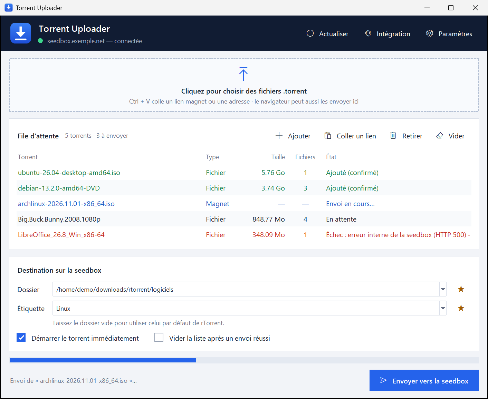
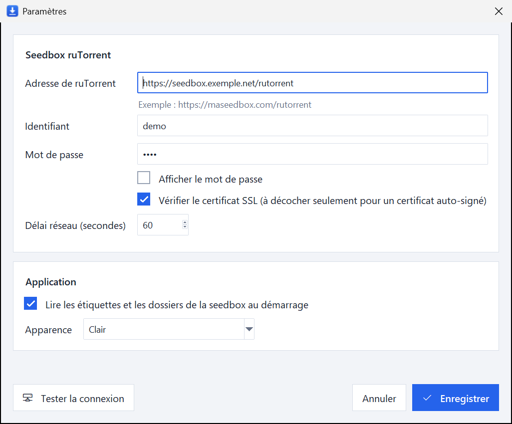
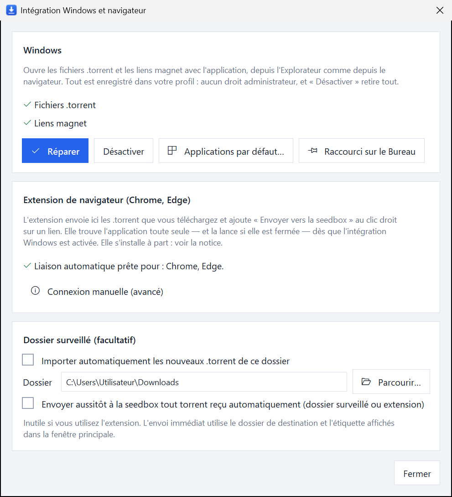
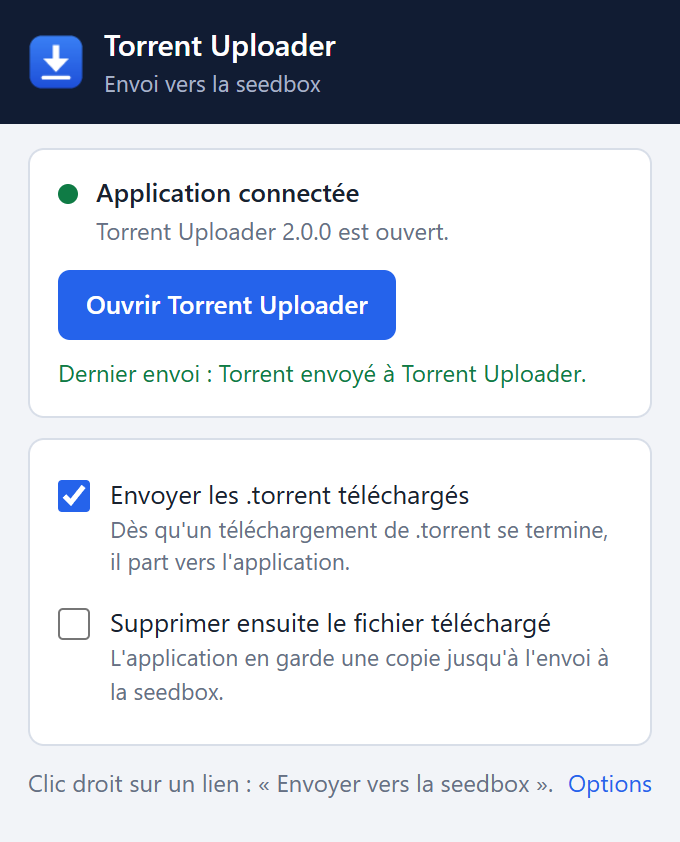
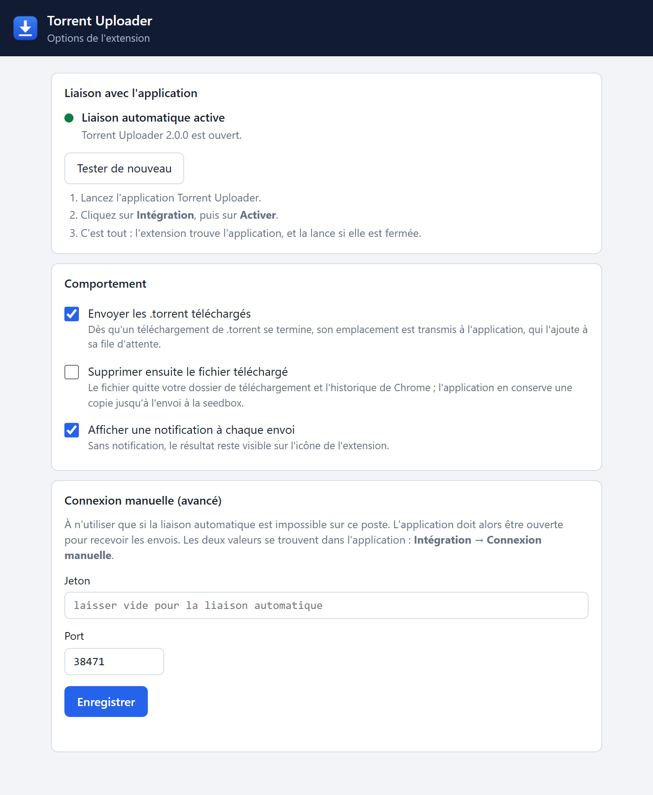
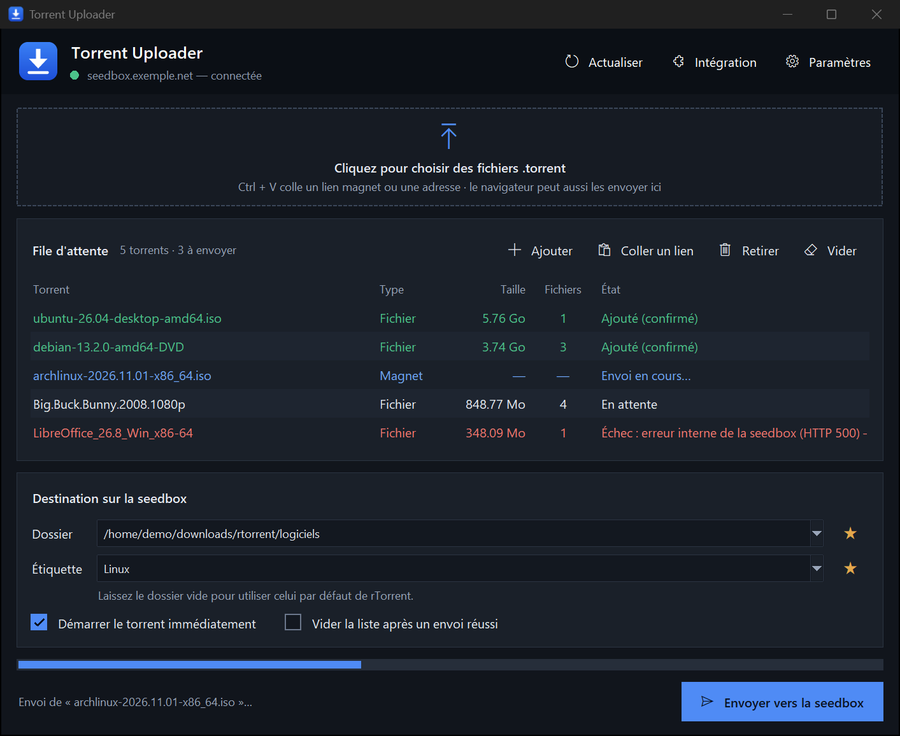

# Torrent Uploader 2

*[Version française](README.fr.md)*

A Windows application (Python + tkinter) that sends `.torrent` files and **magnet** links to a
**ruTorrent / rTorrent** seedbox, letting you pick the destination folder and the label each time.



> The user interface is in French; the screenshots below show it as it is.

Torrents can come in three ways:

- **from Windows**: double-click a `.torrent`, click a magnet link, or drag and drop onto the
  application or its shortcut;
- **from the browser** (Chrome or Edge, with the companion extension): a downloaded `.torrent` is
  sent to the application automatically, and right-clicking a link offers "Envoyer vers la seedbox";
- **by hand**: the "Ajouter" button, or <kbd>Ctrl</kbd> + <kbd>V</kbd> to paste a link.

## Contents

1. [Installation](#1-installation)
2. [First launch](#2-first-launch)
3. [Everyday use](#3-everyday-use)
4. [Windows integration](#4-windows-integration)
5. [Chrome and Edge extension](#5-chrome-and-edge-extension)
6. [Watched folder](#6-watched-folder)
7. [Settings](#7-settings)
8. [Data and security](#8-data-and-security)
9. [Upgrading from version 1](#9-upgrading-from-version-1)
10. [Uninstalling](#10-uninstalling)
11. [Troubleshooting](#11-troubleshooting)
12. [How it works](#12-how-it-works)
13. [Development](#13-development)

## 1. Installation

**Requirements**

- Windows 10 or 11.
- **Python 3.8 or later** from [python.org](https://www.python.org/downloads/). Keep the default
  installer options (they install `pythonw.exe` and the `.pyw` file association).
- A **ruTorrent** seedbox: its address, your user name and password.
- Optional: **Google Chrome** or **Microsoft Edge**, for the extension.

> **Beware of the Microsoft Store "Python".** If the `python` command opens the Microsoft Store,
> Python is not really installed: install it from python.org. The application refuses to register
> itself with Windows using that placeholder.

**Setup**

1. Copy the **Torrent Uploader** folder wherever you like (for example `Documents`). Nothing else
   needs installing.
2. If you want the browser extension, also copy the extension folder to a place where it will stay:
   the browser reads it permanently.
3. Optional: to **drag and drop straight into the window**, run `pip install tkinterdnd2`. Without
   it everything else works (Add button, shortcut, pasting, browser).

## 2. First launch

Double-click **Torrent Uploader.pyw** (or **Torrent Uploader.bat**). On the very first launch the
settings window opens by itself:



1. **Adresse de ruTorrent**: the address you open in your browser, e.g.
   `https://myseedbox.com/rutorrent`. You can paste it as is, even ending with `/php/addtorrent.php`.
2. **Identifiant** and **Mot de passe**: your web interface credentials.
3. Click **Tester la connexion**: the number of torrents, labels and folders found is displayed.
4. **Enregistrer**.

> **Tip:** then open **Intégration** and click **Activer** (see §4). That is what lets `.torrent`
> files and magnet links open with a single click, and what makes the browser extension work.

## 3. Everyday use

**Adding torrents**

| How | What happens |
|---|---|
| Click the dashed area, or "Ajouter" | Pick `.torrent` files (several at once allowed). |
| Drag and drop files or a folder | Onto the window (with `tkinterdnd2`), the desktop shortcut or `Torrent Uploader.bat`. A folder brings all the `.torrent` files it contains. |
| <kbd>Ctrl</kbd> + <kbd>V</kbd> or "Coller un lien" | Adds the magnet links, `.torrent` addresses and file paths found in the clipboard. |
| Double-click a `.torrent`, click a magnet link | Once the Windows integration is enabled. |
| From the browser | With the extension: a `.torrent` download, or a right-click on a link. |

The same torrent enters the list only once, even if it arrives once as a file and once as a magnet
link: the application compares their info-hashes. If the application is already open, anything new
joins the existing window, which comes to the front.

**Choosing the destination**

- **Dossier** (folder) and **Étiquette** (label) offer what is actually used on the seedbox, read at
  start-up and by **Actualiser** (<kbd>F5</kbd>). You can also type a new value.
- The **star** ★ on the right makes the value a **favourite**: it stays at the top of the list.
- Empty folder: the torrent goes to rTorrent's default folder.
- The lists stay available even when the seedbox does not answer (with the date they were read).

**Sending**

Click **Envoyer vers la seedbox** (or <kbd>Ctrl</kbd> + <kbd>Enter</kbd>). Each row shows its
**state**; double-click a row to see the full details.

| State | Meaning |
|---|---|
| Ajouté (confirmé) | The application checked that the torrent is on the seedbox. |
| Ajouté (confirmé malgré une erreur passagère) | The seedbox answered with an error, but the torrent did arrive. |
| Ajouté (après réparation du cache ruTorrent) | ruTorrent was stuck; the application repaired it and resent the torrent (see §11). |
| Envoyé (non confirmé) | Accepted by the seedbox, but could not be checked (`http` address with no known hash, or slow seedbox). |
| Échec : … | The reason is given. "Réessayez dans un instant" means a temporary problem. |

Options under the destination: **Démarrer le torrent immédiatement** (otherwise it is added
stopped) and **Vider la liste après un envoi réussi** (clear sent rows).

**Keyboard shortcuts**: <kbd>Ctrl</kbd> + <kbd>V</kbd> paste links · <kbd>Del</kbd> remove selected
rows · <kbd>F5</kbd> refresh labels and folders · <kbd>Ctrl</kbd> + <kbd>Enter</kbd> send.

## 4. Windows integration

**Intégration** button in the header, then **Activer**.



Once enabled:

- double-clicking a `.torrent` file adds it to the queue;
- clicking a `magnet:` link in the browser opens the application (the browser asks for confirmation
  the first time: tick "Always allow");
- the browser extension can reach the application, and start it if it is closed;
- the application appears in the "Open with" menu and in Windows "Default apps".

**Raccourci sur le Bureau** creates a desktop icon you can drop `.torrent` files onto.

> **No administrator rights.** Everything is written to your own Windows profile, and
> **Désactiver** removes exactly what was added — without touching anything another program
> registered.

> **Another torrent client installed?** The application never takes its place by force: it adds
> itself to the "Open with" menu. To make it the default, click **Applications par défaut…**:
> Windows requires you to make that choice yourself.

If you move the application folder or reinstall Python, just launch the application once: the
integration updates itself (or click **Mettre à jour**).

## 5. Chrome and Edge extension

The extension forwards the torrents you meet in the browser to the application:

- **automatic capture**: as soon as a `.torrent` download finishes, the application adds it to its
  queue, wherever you saved it;
- **right-click** on a magnet or `.torrent` link → "Envoyer vers la seedbox (Torrent Uploader)". On a
  private tracker the file is read with your logged-in session on that site.

It needs **no configuration**: it finds the application on its own and **starts it if it is
closed** (native messaging).

**Installing in Chrome**

1. In the application: **Intégration → Activer**. This is required: it declares the relay to the
   application to Chrome.
2. In Chrome, open `chrome://extensions`.
3. Top right, turn on **Developer mode**.
4. Click **Load unpacked** and choose the extension folder (the one containing `manifest.json`).
5. Click the extensions icon (puzzle piece), then the pin next to "Torrent Uploader".
6. Click that icon: a **green dot** confirms everything is ready.

**Edge**: same steps at `edge://extensions` — "Developer mode" is at the bottom left, then
"Load unpacked".



> **Do not move the extension folder.** The browser reads the extension from it. To move it: remove
> it from `chrome://extensions`, move the folder, then load it again. It is not published on the
> Chrome Web Store, hence developer mode; Chrome may remind you from time to time that such
> extensions are active.

**Extension settings** (in its popup, or right-click the icon → Options)

| Setting | Effect |
|---|---|
| Envoyer les .torrent téléchargés | Automatic capture (on by default). When off, only the right-click sends. |
| Supprimer ensuite le fichier téléchargé | The `.torrent` leaves your download folder and history; the application keeps a copy until it is sent. |
| Afficher une notification | Without notifications, the result is still shown on the icon (green ✓ or red !). |
| Connexion manuelle | Fallback when native messaging is impossible: token and port copied from the application (Intégration → Connexion manuelle). The application must then be open. |



> **Sending immediately.** By default, torrents received from the browser wait in the queue until
> you click "Envoyer". To send them right away, tick in the application **Intégration → "Envoyer
> aussitôt à la seedbox tout torrent reçu automatiquement"**: the folder and label shown in the main
> window are then used.

## 6. Watched folder

Optional, in **Intégration**: the application can watch a folder (Downloads by default) and import
each new `.torrent` that appears there. Useful with a browser other than Chrome or Edge; pointless
with the extension.

- Files already present at start-up are ignored: only new ones count.
- A download in progress (`.crdownload`) is only taken once complete.
- An error page saved under a `.torrent` name is discarded.

## 7. Settings

| Setting | Use |
|---|---|
| Vérifier le certificat SSL | Untick only for a seedbox with a self-signed certificate. |
| Délai réseau | Maximum time to wait for the seedbox (60 s by default). |
| Lire les étiquettes et les dossiers au démarrage | Otherwise use "Actualiser". |
| Apparence | Automatic (follows Windows), light or dark. |



## 8. Data and security

Your settings are stored in your Windows profile, not next to the program: the application folder
can be copied, shared or replaced without ever carrying a password.

Location: `%APPDATA%\TorrentUploader` (paste it into the Explorer address bar).

| File | Contents |
|---|---|
| `config.json` | Settings, seedbox address and credentials, favourites, last lists read. |
| `ipc_token.txt` | Local service key (created automatically). |
| `erreurs.log` | Error log, useful when something goes wrong. |
| `recus\` | Copies of `.torrent` files received from the browser, deleted once sent (or after a week). |
| `native-host\` | Relay used by the browser extension. |

> **Password.** It is stored in plain text in `config.json`, protected by your Windows session
> permissions. Do not share that file.

The application listens on the loopback interface (`127.0.0.1`, port 38471) to keep a single window
open and receive items. This service is unreachable from the network, rejects any request without
its key, and a web page can neither drive it nor read its answers. The extension relay can only be
used by the declared extension.

## 9. Upgrading from version 1

- **Your settings are carried over automatically** if version 2 replaces version 1 in the same
  folder: on first launch the old `config.json` is moved to your profile (§8). Otherwise, copy it
  yourself to `%APPDATA%\TorrentUploader`.
- **The Windows integration updates itself** if it was enabled; the extension link is added.
- **The extension must be replaced**: remove the old one from `chrome://extensions`, then load the
  new one (§5). It no longer needs the token.
- `Activer l'integration Windows.bat`, `Desactiver l'integration Windows.bat` and
  `windows_integration.py` are gone: everything goes through the **Intégration** button.

## 10. Uninstalling

1. In the application: **Intégration → Désactiver**.
2. In `chrome://extensions`: **Remove** the extension.
3. Delete the application and extension folders, and the desktop shortcut.
4. To erase your settings too: delete `%APPDATA%\TorrentUploader`.

## 11. Troubleshooting

| Symptom | Likely cause and fix |
|---|---|
| "Authentification refusée (HTTP 401)" | Wrong user name or password. |
| "Page introuvable (HTTP 404)" | The address does not point to ruTorrent: check it in a browser. |
| "Erreur SSL" | Self-signed certificate: untick "Vérifier le certificat SSL". |
| "Erreur interne de la seedbox (HTTP 500)" | rTorrent is busy or restarting. The application retries on its own (after 15 s, 30 s, 1 min, 2 min, 5 min) and keeps the lists it already knows. |
| Sends fail repeatedly while ruTorrent works in the browser | Known ruTorrent bug (before 5.3.13): its internal cache gets corrupted if a page loads while rTorrent restarts. The application repairs it and resends the torrent. You can also reload ruTorrent in the browser. |
| Folders or labels missing from the lists | Click "Actualiser" (<kbd>F5</kbd>). The lists only show what at least one torrent uses; type any other value and make it a favourite ★. |
| The extension icon says "Liaison non activée" | Enable the integration in the application (§4), then reopen the extension popup. |
| A downloaded `.torrent` does not reach the application | Check in the extension popup that "Envoyer les .torrent téléchargés" is ticked. The file name must end with `.torrent`. |
| Nothing happens when double-clicking a `.torrent` | Intégration → Mettre à jour. If another client has priority, use "Open with" or "Applications par défaut…". |
| "Le service local n'a pas pu démarrer (port 38471 occupé)" | Another program uses that port. Change it in `config.json` (`ipc_port` key); the extension adapts by itself. |
| The application does not open | Run `Torrent Uploader.bat`: it reports a missing or unusable Python. A start-up error is shown in a window, with details in `%APPDATA%\TorrentUploader\erreurs.log`. |

## 12. How it works

- **Sending**: ruTorrent's `php/addtorrent.php` (file as `multipart/form-data`, magnet link or
  address in the `url` field), with the folder (`dir_edit`) and the label (`label`).
- **Reading the lists**: a direct XML-RPC request to rTorrent through the `httprpc` plugin (four
  fields per torrent), immune to ruTorrent's cache; falls back to `mode=list` when needed.
- **Confirmation**: the torrent's info-hash (SHA-1 of its `info` section, or the magnet's) is looked
  up on the seedbox.
- **Browser**: the extension talks to a native messaging host (a Python relay started by the
  browser), which forwards to the application or starts it.

**Command line**

| Command | Effect |
|---|---|
| `python torrent_uploader.py file.torrent "magnet:?…"` | Opens the application with these items queued |
| `python torrent_uploader.py --register` / `--unregister` | Enables / removes the integration |
| `python torrent_uploader.py --status` | Shows the integration state |
| `python torrent_uploader.py --version` | Shows the version |

## 13. Development

| Path | Role |
|---|---|
| `torrent_uploader.py` | entry point (launched by Windows: keep its name and location stable) |
| `Torrent Uploader.pyw`, `Torrent Uploader.bat` | console-less launchers |
| `native_host.py` | native messaging host, started by the browser |
| `tuploader/torrentfile.py` | `.torrent` (bencode) and magnet link parsing |
| `tuploader/rutorrent.py` | ruTorrent client: adding, lists, retries |
| `tuploader/service.py` | local service: single instance, receiving items |
| `tuploader/nativehost.py` | browser → application relay (starts the app if needed) |
| `tuploader/winintegration.py` | Windows associations, native host, shortcut |
| `tuploader/ui/` | user interface: light/dark theme, widgets, windows |
| `tuploader/paths.py`, `config.py` | data locations, settings |
| `tests/` | unit tests (`unittest`) and an end-to-end test in Chrome (`tests/e2e`) |
| `tools/` | icons, screenshots, PDF manual, distribution build |

```bash
python -m unittest discover -s tests -t .
python tests/e2e/run_e2e.py --extension chrome-extension
python tools/build_dist.py
```

The unit tests run in a sandbox: data redirected to a temporary folder, fake ruTorrent servers on
the loopback interface, registry limited to a test key deleted afterwards. The end-to-end test
(Node.js and Chrome required) temporarily points Chrome's native host registry key at a test host,
then restores it. `tools/build_dist.py` builds `Torrent Uploader - Distribution` next to the project:
application, extension (without its private key), PDF and HTML manual (`docs/notice.html`, in
French) and a `.zip` of everything.

**Contract with the extension**

- **native messaging** — host `com.torrentuploader.host`, restricted to the extension
  `ejbkdabahogcncpmabcgmenfmefokgjj` (ID fixed by the public key in its manifest);
- **local HTTP service** — `127.0.0.1:38471` (`ipc_port` key), routes `/ping`, `/show`, `/add`,
  token required, local `Host` header enforced, CORS granted only to `chrome-extension://` origins.
